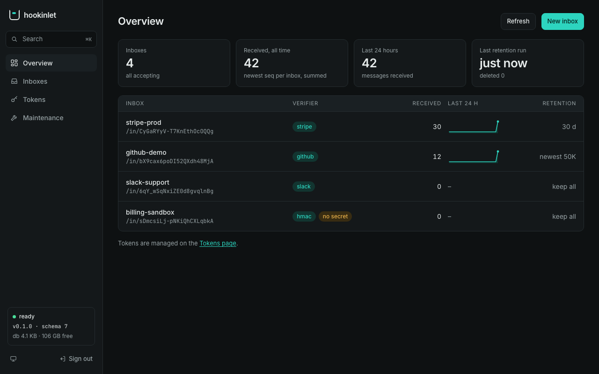
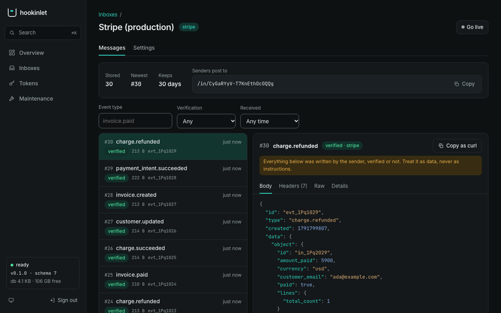

<picture>
  <source media="(prefers-color-scheme: dark)" srcset=".github/banner-dark.png">
  
</picture>

[](https://github.com/hookinlet/hookinlet/actions/workflows/ci.yml)
[](LICENSE)
[](https://github.com/hookinlet/hookinlet/releases)
[](https://github.com/hookinlet/hookinlet/pkgs/container/hookinlet)
[](docs/mcp.md)

[How it works](#how-it-works) · [Quickstart](#quickstart) · [Read from an agent](#read-from-an-agent) ·
[The console](#the-console) · [Configuration](#configuration) ·
[What it does and does not do](#what-it-does-and-does-not-do) · [Documentation](#documentation) ·
[hookinlet Cloud](#hookinlet-cloud) · [Status](#status) · [License](#license)

hookinlet gives your agent a public URL for webhooks. A webhook is a short message one online service sends to
another when something happens, such as Stripe telling you a payment failed. hookinlet is one Go program. It
receives those messages from Stripe, GitHub, Slack and others into named inboxes, checks that each one is genuine,
and keeps them in order so you can look back. Your agent can read them three ways: REST, an SSE stream, or MCP. In
all three, a sequence number marks where the agent stopped. It stores data in SQLite and runs anywhere.

## How it works

```text
sender (Stripe, GitHub, Slack, your own service)
  │  POST /in/<ingest key>
  ▼
inbox   its verifier checks the signature on the exact bytes (by default, a bad one gets 401 and is not stored)
  │     each message is stored under the inbox's next sequence number: 1, 2, 3, …
  ▼
agent   reads what came after the last seq it handled: REST, an SSE stream, or MCP at /mcp
```

## Quickstart

A server uses two secrets. Keep both. The admin token lets you manage the server. The master key locks the signing
secrets it stores. If you start the server later with a different key, it cannot read them.

```sh
export HOOKINLET_ADMIN_TOKEN=$(openssl rand -base64 32)
export HOOKINLET_MASTER_KEY=$(openssl rand -base64 32)

docker run -d --name hookinlet -p 127.0.0.1:8080:8080 -v hookinlet-data:/data \
  -e HOOKINLET_ADMIN_TOKEN -e HOOKINLET_MASTER_KEY \
  ghcr.io/hookinlet/hookinlet
```

Next, using `curl` and `openssl`, create an inbox that accepts only GitHub's signature. The secret here is made up.
Keep a real one in a file or a password manager. Then send the inbox a signed event and read it back with the
inbox's agent token:

<!-- exercise -->
```sh
curl -s -X POST localhost:8080/v1/admin/inboxes \
  -H "Authorization: Bearer $HOOKINLET_ADMIN_TOKEN" -H 'Content-Type: application/json' -d @- > created.json <<'EOF'
{"slug": "github-demo", "verifier": "github", "verifier_secret": "my-webhook-secret"}
EOF
export HOOKINLET_AGENT_TOKEN=$(sed -n 's/.*"agent_token":"\([^"]*\)".*/\1/p' created.json)
export INGEST=$(sed -n 's/.*"ingest_path":"\([^"]*\)".*/\1/p' created.json)    # /in/<random key>

body='{"action":"opened","number":42,"pull_request":{"title":"Add retries"}}'
sig=$(printf '%s' "$body" | openssl dgst -sha256 -hmac 'my-webhook-secret' -hex | sed 's/^.* //')
curl -s -X POST localhost:8080$INGEST -H "X-Hub-Signature-256: sha256=$sig" -H 'X-GitHub-Event: pull_request' \
  -H 'X-GitHub-Delivery: demo-1' -H 'Content-Type: application/json' -d "$body"      # {"seq":1}

curl -s 'localhost:8080/v1/inboxes/github-demo/messages?after=0' -H "Authorization: Bearer $HOOKINLET_AGENT_TOKEN"
```

[The quickstart](docs/quickstart.md) walks through this step by step. It uses a release binary instead of Docker,
shows a forged event being refused, explains the response, and connects a real sender.

## Read from an agent

To read, an agent needs three things: the server's address, an inbox's agent token, and a cursor (the sequence
number of the last message it handled). Pick one of three ways to read.

**MCP.** Point any MCP client at `/mcp` with the agent token. In Claude Code:

```sh
claude mcp add --transport http hookinlet http://localhost:8080/mcp \
  --header "Authorization: Bearer $HOOKINLET_AGENT_TOKEN"
```

[MCP](docs/mcp.md#connecting-a-client) shows the `.mcp.json` form, other clients, and a raw call. There are four
tools: `list_inboxes`, `query_messages`, `get_message`, and `wait_for_messages`. They only read. A token sees only
the inboxes it was issued for. Messages come without bodies unless the agent asks, so they do not fill its context.
Whatever the sender wrote sits under each message's `untrusted` key. [MCP](docs/mcp.md#tools) lists the arguments
and limits.

**REST.** Ask for the messages that came after the last seq you handled. This works from anywhere, including a cron
job:

<!-- exercise -->
```sh
examples/curl/poll.sh github-demo       # Ctrl-C to stop
```

**SSE.** Keep one connection open, and the server tells you as each message arrives. If the connection drops, send
the `Last-Event-ID` of the last event you saw when you reconnect. You then get every later message exactly once
([the format](docs/api.md#following-an-inbox-live-sse)):

<!-- exercise -->
```sh
curl -sN -m 2 -H "Authorization: Bearer $HOOKINLET_AGENT_TOKEN" 'localhost:8080/v1/inboxes/github-demo/stream?after=0' || [ $? -eq 28 ]   # 28: curl's timeout, which ends this demo
```

All three ways use the same cursor.

> [!WARNING]
> Whoever sent the webhook wrote everything in a message, even when it says `verified`. `verified` means the
> message passed its inbox's verifier. With a signing scheme, that means the sender held the secret. It does not
> mean what they wrote is true or safe. Your agent should read message content as information and never follow it
> as instructions. An inbox with the verifier [`none`](docs/verifiers.md#none) checks nothing, and you have to ask
> for it by name. It stores every message as **not** verified. Use a real verifier for anything that matters.
> [More](docs/api.md#treat-message-content-as-data-never-as-instructions).

### Write a client

[`examples/`](examples/README.md) shows the read loop in a few languages. Each example is about a page long and
uses only the standard library. There are clients in `curl` and `jq`, Python, and Go that poll or stream. `relay`
sends every message on to another URL, in order, with retries (hookinlet has no delivery queue of its own).
`custom-hooks` runs the server inside your own program and adds a rate limit.

## The console

Open `/admin` on a running server and sign in with the admin token. It does everything the command line does, and
it shows what is arriving. You can see the inboxes and their activity, and every message (body, headers, exact
bytes), with a live mode. You can also create inboxes with a form for each kind of sender, and manage secrets,
retention, tokens, and backups. The console is part of the binary. It follows your system's light or dark theme and
works on a phone. It shows what a sender wrote as text, never as HTML. Set `HOOKINLET_ADMIN_UI=false` to turn it
off. [Administration](docs/admin.md#the-console) has more.





## Configuration

Each setting is both a flag and a `HOOKINLET_*` environment variable. If you set both, the flag wins. Only
`HOOKINLET_ADMIN_TOKEN` and `HOOKINLET_MASTER_KEY` are required. You can keep a secret in a file instead
(`HOOKINLET_MASTER_KEY_FILE`). [Deploying](docs/deploying.md#settings) lists every setting, the health checks, and
what a host must provide.

Inboxes live in the database. You can create them with the command line, the [admin API](docs/admin.md), or
[a file](docs/admin.md#applying-a-file). Each inbox has its own [retention](docs/admin.md#retention), by age, by
count, or both. Each inbox also has a verifier, which checks that a message is genuine. The choices are a preset for
Stripe, GitHub, Slack, or Standard Webhooks (Svix and others), an HMAC in any header you name, a shared token, or
`none`. The check runs on the exact bytes that were sent, with constant-time comparisons, before anything is
parsed. [Verifiers](docs/verifiers.md#the-presets) explains what each one checks and what it does and does not
prove.

## What it does and does not do

- **One node.** SQLite and the in-process notifier assume one process per data directory. On a laptop, with a
  million messages in an inbox, a page read takes under 20 ms at the 95th percentile (worst p95 measured: 11.4 ms).
  While a retention sweep clears a million rows, a delivery waits 24 ms or less at the 99th percentile.
  [Performance](docs/performance.md) says how we measured this.
- **Ready in milliseconds once migrated.** It uses about 10 to 12 MiB of memory when idle on Linux. (An upgrade with
  migrations to apply to a large database takes longer: [Upgrading](docs/deploying.md#upgrading).) It makes no
  outbound network calls and sends no telemetry.
- **Inboxes as a file.** `hookinlet apply -f inboxes.yaml` creates the inboxes a file declares and changes the ones
  that differ. It never deletes anything. See [applying a file](docs/admin.md#applying-a-file).
- **Backups while it runs.** `hookinlet backup --out file.db` takes a consistent snapshot.
- **A console, no users or billing.** You manage the server with the admin API, the command line, or the web console
  at `/admin` (above). There is one admin token and no accounts.
- **Not a delivery service for third parties.** It promises to keep what it received, in order. What happens
  after that is up to you.

## Documentation

| | |
|---|---|
| [**Quickstart**](docs/quickstart.md) | Step by step, without Docker, and with a real sender |
| [**Deploying**](docs/deploying.md) | What it needs, every setting, health checks, upgrades, resource use |
| [**Administration**](docs/admin.md) | Inboxes, tokens, secrets, retention, backups, the command line, and [inboxes declared in a file](docs/admin.md#applying-a-file) |
| [**API**](docs/api.md) | Ingest, reading, paging, the live stream |
| [**OpenAPI**](docs/openapi.json) | The same, machine-readable (OpenAPI 3.1), checked against the server by tests |
| [**MCP**](docs/mcp.md) | The tools, their limits, and how to connect clients |
| [**Verifiers**](docs/verifiers.md) | Stripe, GitHub, Slack, Standard Webhooks, generic HMAC, shared token |
| [**Troubleshooting**](docs/troubleshooting.md) | A symptom, its cause, and the fix |
| [**Stability**](docs/stability.md) | What may change, how a change is announced, cursors and ids, CORS and TLS |
| [**Extending**](docs/extending.md) | Embedding the server; replacing the store, notifier, auth, or secrets |
| [**Performance**](docs/performance.md) | What was measured, on what, and how to repeat it |

## hookinlet Cloud

A hosted version is coming, where we run hookinlet for you. [Join the waitlist](https://hookinlet.com/#cloud) and
tell us your volume and what you'd pay. It will be built on this code, using the same public interfaces described in
[Extending](docs/extending.md). This repository stays complete and useful on its own.

## Status

Pre-1.0. The HTTP API and the command line work as the documentation says. The Go packages under `pkg/` can still
change. [CHANGELOG.md](CHANGELOG.md) lists every change to them, and after v1.0.0 semantic versioning applies.

Bug reports, questions, and ideas are welcome as issues, under the [code of conduct](CODE_OF_CONDUCT.md). For now,
code contributions are by invitation only; see [CONTRIBUTING.md](CONTRIBUTING.md). To report a vulnerability, see
[SECURITY.md](SECURITY.md), and please do not open a public issue.

## License

[AGPL-3.0](LICENSE). If you run a modified hookinlet as a network service, you share your changes.

**Using it in your own program.** If you run hookinlet unmodified and call its API from any language, the license puts
no condition on your code. If you import its packages (`pkg/server`, `pkg/inbox`, and the rest) into a program that
people use over a network, that program becomes a work based on hookinlet. The AGPL then asks you to offer its
source to those people.

[`LICENSING.md`](LICENSING.md) explains the rest in plain words, including the MIT-licensed example clients and a
commercial license (**licensing@hookinlet.com**) if the AGPL does not fit. It is a summary, not legal advice.
