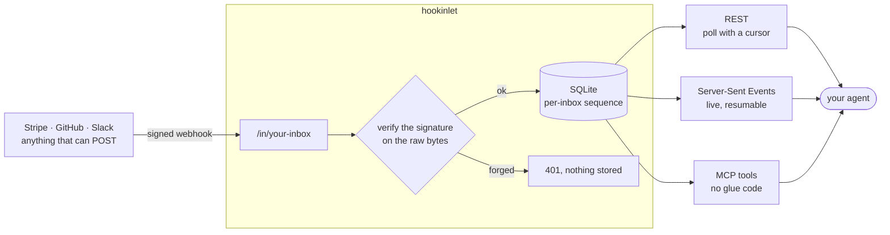

<div align="center">

# hookinlet

**A webhook inbox for AI agents.**

Point Stripe, GitHub, Slack, or anything that can `POST` at an inbox. hookinlet checks the signature,
keeps the exact bytes, and lets your agent read them when it is ready: over REST, a live stream, or MCP tools.

[](https://github.com/hookinlet/hookinlet/actions/workflows/ci.yml)
[](https://github.com/hookinlet/hookinlet/releases)
[](LICENSE)


</div>

---

An agent cannot receive a webhook. It has no public address, it is not running when the event fires, and it
may take a minute to think about the last one. So something has to stand in the middle: accept the request,
prove the sender is who it says, keep it safely, and hand it over later, in order, without losing or repeating
anything.

That is all hookinlet does. It is one Go binary and one SQLite file, with nothing else to run.



## Why it is built this way

- **The cursor is the sequence number.** Every message gets the next number in its inbox, assigned in commit
  order. An agent that remembers the last number it handled and asks for what came after sees every message
  exactly once, in order, across restarts and reconnects. No acknowledgements, no per-reader state on the
  server, no queue to drain.
- **Signatures are checked on the bytes that were sent,** before anything is parsed, with constant-time
  comparisons and, for the schemes that sign a timestamp (Stripe, Slack, Standard Webhooks), a tolerance window
  against replays. Bodies are stored byte for byte, so a relay can forward them and the receiver can still verify
  the original signature.
- **Content from a stranger is treated as one.** Every message says whether it passed its inbox's verifier,
  unverified content never contributes an event type or a delivery id, and the docs and the MCP server tell agents
  to treat message content as data and never as instructions.
- **It stays out of your way.** Ready in milliseconds, about 10 MiB of memory idle, one process per data
  directory. No outbound network calls, no telemetry, no phone-home.

## Quick start

You need `curl` and `openssl`, and for the examples below `jq`, `python3`, and Go. The server itself needs
nothing.

Two secrets configure a server, and you must **keep both**: the admin token is how you manage it, and the master
key encrypts the signing secrets it stores, so a server started later with a different key cannot read them.

With Docker (the container listens on port 8080 of this machine only):

```sh
export HOOKINLET_ADMIN_TOKEN=$(openssl rand -base64 32)
export HOOKINLET_MASTER_KEY=$(openssl rand -base64 32)

docker run -d --name hookinlet -p 127.0.0.1:8080:8080 -v hookinlet-data:/data \
  -e HOOKINLET_ADMIN_TOKEN -e HOOKINLET_MASTER_KEY \
  ghcr.io/hookinlet/hookinlet:latest
```

Or with a binary: download one from the [releases page](https://github.com/hookinlet/hookinlet/releases) (Linux and
macOS, amd64 and arm64, static, nothing to install), or build one from a clone with Go:

```sh
go build -o hookinlet ./cmd/hookinlet     # then put ./hookinlet on your PATH
```

Then [create an inbox, send it a signed webhook, and read it back](#receive-your-first-signed-webhook).
The deployment guide covers [what it needs](docs/deploying.md): a writable data directory, TLS in front, and
one instance per directory.

## Receive your first signed webhook

This runs on your machine, from a clone of this repository, with the `hookinlet` binary on your `PATH`. It plays
the part of GitHub with `openssl`, so there is nothing to sign up for. Every command here is run by the project's
tests, in this order, in one shell.

Start a server. (If you started the Docker container above, skip this block and keep using the shell where you
exported the two secrets: the walk below talks to whichever server answers on port 8080.) This one uses a
throwaway data directory, so the walk starts clean every time, and listens on this machine only:

<!-- exercise -->
```sh
export HOOKINLET_ADMIN_TOKEN=$(openssl rand -base64 32)
export HOOKINLET_MASTER_KEY=$(openssl rand -base64 32)
export HOOKINLET_DATA_DIR=$(mktemp -d)
export HOOKINLET_LISTEN_ADDR=127.0.0.1:8080
export HOOKINLET_LOG_LEVEL=warn
hookinlet serve &
for i in $(seq 50); do curl -sf localhost:8080/readyz >/dev/null && break; sleep 0.2; done
curl -sf localhost:8080/readyz      # {"status":"ready"}; if this fails, something else may be using port 8080
```

Create an inbox that only accepts GitHub's signature, for a secret you choose (this one is made up; a real one
belongs in a file or a password manager, never in a command line). The response carries the **agent token** that
reads this inbox. It is shown once:

<!-- exercise -->
```sh
curl -s -X POST localhost:8080/admin/inboxes \
  -H "Authorization: Bearer $HOOKINLET_ADMIN_TOKEN" -H 'Content-Type: application/json' -d @- > created.json <<'EOF'
{"slug": "github-demo", "verifier": "github", "verifier_secret": "my-webhook-secret"}
EOF

export HOOKINLET_AGENT_TOKEN=$(sed -n 's/.*"agent_token":"\([^"]*\)".*/\1/p' created.json)
```

Send it a webhook signed the way GitHub signs them (HMAC-SHA256 of the body, in `X-Hub-Signature-256`):

<!-- exercise -->
```sh
body='{"action":"opened","number":42,"pull_request":{"title":"Add retries"}}'
sig=$(printf '%s' "$body" | openssl dgst -sha256 -hmac 'my-webhook-secret' -hex | sed 's/^.* //')

curl -s -X POST localhost:8080/in/github-demo \
  -H "X-Hub-Signature-256: sha256=$sig" -H 'X-GitHub-Event: pull_request' \
  -H 'X-GitHub-Delivery: demo-1' -H 'Content-Type: application/json' -d "$body"
```

```json
{"seq":1}
```

Now change one character of the body and send the same signature. It is refused, and nothing is stored:

<!-- exercise -->
```sh
curl -s -X POST localhost:8080/in/github-demo \
  -H "X-Hub-Signature-256: sha256=$sig" -H 'X-GitHub-Event: pull_request' \
  -H 'Content-Type: application/json' -d '{"action":"opened","number":43}'
```

```json
{"error":{"code":"verification_failed","message":"webhook verification failed"}}
```

Read the message back as an agent would, with the agent token:

<!-- exercise -->
```sh
curl -s 'localhost:8080/v1/inboxes/github-demo/messages?after=0' -H "Authorization: Bearer $HOOKINLET_AGENT_TOKEN"
```

```json
{"messages":[{"seq":1,"inbox":"github-demo","received_at":"2026-10-11T05:43:16.434979Z","method":"POST",
  "headers":{"X-Github-Event":["pull_request"], "…":"…"},"content_type":"application/json","size":70,
  "verified":true,"verifier":"github","delivery_id":"demo-1","event_type":"pull_request","source_ip":"127.0.0.1",
  "body":{"action":"opened","number":42,"pull_request":{"title":"Add retries"}}, "…":"…"}],
 "next":"/v1/inboxes/github-demo/messages?after=1&limit=50","latest_seq":1}
```

(Shortened here; the [API reference](docs/api.md#messages) lists every field.) `body` is your JSON, as JSON.
`next` is the cursor to keep. To get the exact bytes that were sent, for example to check the signature
yourself, read `/v1/inboxes/github-demo/messages/1/raw`.

When you are done with the walk: `kill %1` stops the server it started, and `rm created.json` removes the file
holding the agent token.

To use a real sender, create the inbox the same way, then give GitHub (or Stripe, or Slack) the URL
`https://<your-host>/in/<slug>` and the same secret. Your server has to be reachable from the internet for
that: put it behind TLS on a host, or, to try it from your laptop, behind any tunnel.

| Sender | `verifier` | What you set |
|---|---|---|
| GitHub | `github` | The webhook's secret |
| Stripe | `stripe` | The endpoint's signing secret (`whsec_…`) |
| Slack | `slack` | The app's signing secret; the `url_verification` handshake is answered for you |
| Svix, and others using [Standard Webhooks](https://www.standardwebhooks.com/) | `standardwebhooks` | The `whsec_…` secret |
| Anything that signs with an HMAC | `hmac` | Which header, algorithm, and encoding |
| Anything that sends a shared token | `token` | The token's header |

Details, replay windows, and what each scheme does and does not prove are in [verifiers](docs/verifiers.md).

## Let an agent read it

An agent needs three things: the server's address, an inbox's agent token, and a cursor. Pick the way that fits.

**Poll.** Ask for what came after the last seq you handled. This works from anywhere, including a cron job:

<!-- exercise -->
```sh
examples/curl/poll.sh github-demo       # Ctrl-C to stop
```

**Follow live.** Hold a Server-Sent Events connection open and be told as messages arrive. A client that
reconnects with the `Last-Event-ID` of the last event it saw gets every later message exactly once:

<!-- exercise -->
```sh
curl -sN -m 2 -H "Authorization: Bearer $HOOKINLET_AGENT_TOKEN" 'localhost:8080/v1/inboxes/github-demo/stream?after=0' || [ $? -eq 28 ]   # 28: curl's timeout, which ends this demo
```

```
retry: 3000

id: 1
event: message
data: {"seq":1,"inbox":"github-demo", …}
```

**Use MCP.** The same reads are tools, so an agent needs no glue code. Add the server to an MCP client
(here Claude Code) with the inbox's agent token:

```sh
claude mcp add --transport http hookinlet http://localhost:8080/mcp \
  --header "Authorization: Bearer $HOOKINLET_AGENT_TOKEN"
```

The tools are `list_inboxes`, `query_messages`, `get_message`, and `wait_for_messages`, which waits up to a
timeout (30 seconds by default, at most 60) for something new and is the whole polling loop in one call. They are read-only, a token sees only its own
inbox, and large bodies are cut with a flag so they do not fill the agent's context. See [MCP](docs/mcp.md) for
the tools, other clients' configuration, and a raw `curl` call:

<!-- exercise -->
```sh
curl -s localhost:8080/mcp -H "Authorization: Bearer $HOOKINLET_AGENT_TOKEN" \
  -H 'Content-Type: application/json' -H 'Accept: application/json, text/event-stream' \
  -d '{"jsonrpc":"2.0","id":1,"method":"tools/call","params":{"name":"query_messages","arguments":{"inbox":"github-demo","after":0}}}'
```

**Write a client.** [`examples/`](examples) has the loop in a few languages, each about a page and using only
the standard library:

| Example | |
|---|---|
| [`examples/curl`](examples/curl) | `poll.sh` and `stream.sh`, with `curl` and `jq` |
| [`examples/python`](examples/python) | `agent.py`, polling or streaming |
| [`examples/go-agent`](examples/go-agent) | the same in Go, polling or streaming |
| [`examples/relay`](examples/relay) | forwards every message to another URL, with retries, in order; see below |
| [`examples/custom-hooks`](examples/custom-hooks) | the server embedded in your own program, with a rate limit added |

<!-- exercise -->
```sh
python3 examples/python/agent.py github-demo --count 1
go run ./examples/go-agent -inbox github-demo -n 1
```

> [!WARNING]
> Everything in a message was written by whoever sent the webhook, including `verified` ones. `verified` means
> the message passed its inbox's verifier: for a signing scheme, that the sender held the secret, which does not
> make what it wrote true or safe. (An inbox whose verifier is `none`, the default, marks everything verified,
> so use a real verifier for anything that matters.) An agent should treat message content as data to analyze
> and never as instructions to follow.

### Passing webhooks on

Want the webhook to reach an existing service as well? [`examples/relay`](examples/relay) tails an inbox and
POSTs each message to a URL you choose: the original bytes and headers (so the receiver can still check the
sender's signature), at least once and in order, retrying while the destination is down or misconfigured, and
remembering its place across restarts. It skips a message only when the destination refuses that message for good
(a 400, 410, 413, 415, or 422), and says so in its log. Two cautions: schemes that sign a timestamp are checked by
the receiver against a five minute window, so a message delivered after a long outage may be refused; and
headers that say where a request came from are not passed on, but the rest are the sender's, so a receiver should
not take any of them on trust. hookinlet itself keeps no delivery queue, and the relay shows how little one
takes.

## Reference

| | |
|---|---|
| [**Deploying**](docs/deploying.md) | What it needs, every setting, health checks, upgrades, resource use |
| [**Administration**](docs/admin.md) | Inboxes, tokens, secrets, retention, backups, and the command line |
| [**API**](docs/api.md) | Ingest, reading, paging, and the live stream |
| [**OpenAPI**](docs/openapi.json) | The same, machine-readable (OpenAPI 3.1), checked against the server by a test |
| [**MCP**](docs/mcp.md) | The tools, their limits, and how to connect clients |
| [**Verifiers**](docs/verifiers.md) | Stripe, GitHub, Slack, Standard Webhooks, generic HMAC, shared token |
| [**Extending**](docs/extending.md) | Embedding the server; replacing the store, notifier, auth, or secrets |
| [**Performance**](docs/performance.md) | What was measured, on what, and how to repeat it |
| [**Releasing**](docs/releasing.md) | For maintainers |

## What it does and does not do

- **One node.** SQLite and the in-process notifier assume one process per data directory. That serves a lot:
  on a laptop, with a million messages in an inbox, reading a page takes under 20 ms at the 95th percentile
  (worst case measured: 11 ms), and while a million-row retention sweep runs, the store accepts a delivery in under
  about 20 ms at the 99th percentile (the longest wait measured was about 100 ms); see
  [Performance](docs/performance.md) for what was measured and how. Spreading across nodes is not part of this
  project.
- **Retention.** Per inbox, by age, by count, or both, applied on a schedule and on request.
- **Backups.** A consistent snapshot while it runs: `hookinlet backup --out file.db`.
- **No dashboard, users, or billing.** It is a building block. The admin API and the command line are how you
  manage it.
- **Not a queue with delivery guarantees to third parties.** It guarantees what it stored and the order of it.
  What your agent or relay does next is yours.

A hosted version, run for you, is planned. It will be built on this code through the same public interfaces
described in [Extending](docs/extending.md), and this repository will stay complete and useful on its own.

## Status

Pre-1.0. The HTTP API and the command line are what the documentation says. The Go packages under `pkg/` can
still change, and `CHANGELOG.md` lists every change to them; after v1.0.0, semantic versioning applies.

## Contributing and security

Bug reports, questions, and ideas are welcome as issues. Code contributions are by invitation for now; see
[CONTRIBUTING.md](CONTRIBUTING.md). To report a vulnerability, see [SECURITY.md](SECURITY.md) and please do not
open a public issue.

## License

AGPL-3.0-only. See [LICENSE](LICENSE) and [NOTICE](NOTICE).
