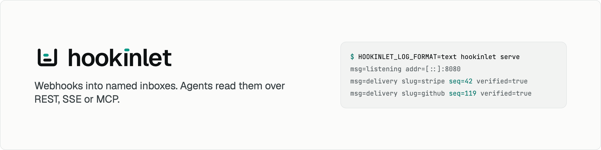

<picture>
  <source media="(prefers-color-scheme: dark)" srcset=".github/banner-dark.png">
  
</picture>

[](https://github.com/hookinlet/hookinlet/actions/workflows/ci.yml)
[](LICENSE)
[](https://github.com/hookinlet/hookinlet/releases)
[](https://github.com/hookinlet/hookinlet/pkgs/container/hookinlet)
[](docs/mcp.md)

hookinlet is a single Go binary that receives webhooks into named inboxes, verifies their signatures, and keeps a
queryable history. Agents read it three ways, REST, an SSE stream, or an MCP endpoint, using a per-inbox sequence
number as the cursor. SQLite by default; runs anywhere.

[Docs](docs) · [Quickstart](#quickstart) · [MCP tools](#read-from-an-agent) · [hookinlet Cloud (waitlist)](https://hookinlet.com/#cloud)

## Quickstart

Run it, send it a signed event, read it back. You need `curl` and `openssl`; the examples further down also use
`jq`, `python3`, and Go. The server needs nothing.

Two secrets configure a server, and you must keep both. The admin token manages it. The master key encrypts the
signing secrets it stores, so a server started later with a different key cannot read them.

```sh
export HOOKINLET_ADMIN_TOKEN=$(openssl rand -base64 32)
export HOOKINLET_MASTER_KEY=$(openssl rand -base64 32)

docker run -d --name hookinlet -p 127.0.0.1:8080:8080 -v hookinlet-data:/data \
  -e HOOKINLET_ADMIN_TOKEN -e HOOKINLET_MASTER_KEY \
  ghcr.io/hookinlet/hookinlet
```

Prefer a binary? Download one from the [releases page](https://github.com/hookinlet/hookinlet/releases) (Linux and
macOS, amd64 and arm64, static), or build it from a clone:

```sh
go build -o hookinlet ./cmd/hookinlet     # then put ./hookinlet on your PATH
```

### Send a signed event, read it back

This walk plays the part of GitHub with `openssl`, so there is nothing to sign up for. Run it from a clone, with
`hookinlet` on your `PATH`. Every command is run by the project's tests, in this order, in one shell.

Start a server. If you started the Docker container above, skip this block and keep the shell where you exported
the two secrets: the walk talks to whichever server answers on port 8080. This one uses a throwaway data directory
and listens on this machine only:

<!-- exercise -->
```sh
export HOOKINLET_ADMIN_TOKEN=$(openssl rand -base64 32)
export HOOKINLET_MASTER_KEY=$(openssl rand -base64 32)
export HOOKINLET_DATA_DIR=$(mktemp -d)
export HOOKINLET_LISTEN_ADDR=127.0.0.1:8080
export HOOKINLET_LOG_LEVEL=warn
hookinlet serve &
for i in $(seq 50); do curl -sf localhost:8080/readyz >/dev/null && break; sleep 0.2; done
curl -sf localhost:8080/readyz      # {"status":"ready"}; if this fails, something else may be using port 8080
```

Create an inbox that accepts only GitHub's signature, for a secret you choose. (This one is made up; a real one
belongs in a file or a password manager, never in a command line.) The response carries the **agent token** that
reads this inbox. It is shown once. The response also carries the **ingest path**, the URL senders post to. Its last part is a
random key, not the slug: whoever has it can post to the inbox, so it is not a name anyone can guess. (The admin API shows it
again whenever you ask.)

<!-- exercise -->
```sh
curl -s -X POST localhost:8080/admin/inboxes \
  -H "Authorization: Bearer $HOOKINLET_ADMIN_TOKEN" -H 'Content-Type: application/json' -d @- > created.json <<'EOF'
{"slug": "github-demo", "verifier": "github", "verifier_secret": "my-webhook-secret"}
EOF

export HOOKINLET_AGENT_TOKEN=$(sed -n 's/.*"agent_token":"\([^"]*\)".*/\1/p' created.json)
export INGEST=$(sed -n 's/.*"ingest_path":"\([^"]*\)".*/\1/p' created.json)    # /in/<random key>
```

Send an event signed the way GitHub signs them, HMAC-SHA256 of the body in `X-Hub-Signature-256`:

<!-- exercise -->
```sh
body='{"action":"opened","number":42,"pull_request":{"title":"Add retries"}}'
sig=$(printf '%s' "$body" | openssl dgst -sha256 -hmac 'my-webhook-secret' -hex | sed 's/^.* //')

curl -s -X POST localhost:8080$INGEST \
  -H "X-Hub-Signature-256: sha256=$sig" -H 'X-GitHub-Event: pull_request' \
  -H 'X-GitHub-Delivery: demo-1' -H 'Content-Type: application/json' -d "$body"
```

```json
{"seq":1}
```

Change one character of the body and send the same signature. It is refused, and nothing is stored:

<!-- exercise -->
```sh
curl -s -X POST localhost:8080$INGEST \
  -H "X-Hub-Signature-256: sha256=$sig" -H 'X-GitHub-Event: pull_request' \
  -H 'Content-Type: application/json' -d '{"action":"opened","number":43}'
```

```json
{"error":{"code":"verification_failed","message":"webhook verification failed"}}
```

Read the inbox from the start, with the agent token:

<!-- exercise -->
```sh
curl -s 'localhost:8080/v1/inboxes/github-demo/messages?after=0' -H "Authorization: Bearer $HOOKINLET_AGENT_TOKEN"
```

```json
{"messages":[{"seq":1,"inbox":"github-demo","received_at":"2026-10-11T05:43:16.434979Z","method":"POST",
  "headers":{"X-Github-Event":["pull_request"], "…":"…"},"content_type":"application/json","size":70,
  "verified":true,"verifier":"github","delivery_id":"demo-1","event_type":"pull_request","source_ip":"127.0.0.1",
  "body":{"action":"opened","number":42,"pull_request":{"title":"Add retries"}}, "…":"…"}],
 "next":"/v1/inboxes/github-demo/messages?after=1&limit=50","latest_seq":1}
```

Shortened; the [API reference](docs/api.md#messages) lists every field. `body` is your JSON, as JSON. `next` is the
cursor to keep. For the exact bytes that were sent, read `/v1/inboxes/github-demo/messages/1/raw`.

When you are done: `kill %1` stops the server this walk started, and `rm created.json` removes the file holding
the agent token.

### With a real sender

Stripe's CLI forwards test events with a real signature. This is the same loop against Stripe (it needs a Stripe
account, so it is shown, not run by the tests):

```sh
# the signing secret Stripe will use, whsec_…
secret=$(stripe listen --print-secret)

# create the inbox with that secret
curl -s -X POST localhost:8080/admin/inboxes \
  -H "Authorization: Bearer $HOOKINLET_ADMIN_TOKEN" -H 'Content-Type: application/json' -d @- > created.json <<EOF
{"slug": "stripe", "verifier": "stripe", "verifier_secret": "$secret"}
EOF
# keep the agent token in HOOKINLET_AGENT_TOKEN, as above, and forward Stripe's test events to the inbox
INGEST=$(sed -n 's/.*"ingest_path":"\([^"]*\)".*/\1/p' created.json)
stripe listen --forward-to localhost:8080$INGEST &

# send some events, then read the inbox
stripe trigger invoice.paid
curl -s 'localhost:8080/v1/inboxes/stripe/messages?after=0&fields=summary' \
  -H "Authorization: Bearer $HOOKINLET_AGENT_TOKEN" | jq -c '.messages[] | {seq, event_type, verified}'
```

```
{"seq":1,"event_type":"customer.created","verified":true}
…
{"seq":5,"event_type":"invoice.paid","verified":true}
```

For GitHub, Slack, or your own service, give the sender the inbox's `ingest_url` (the admin API shows it; `HOOKINLET_PUBLIC_BASE_URL` sets the host part) and the same secret. The
server must be reachable from the internet for that: put it behind TLS, or use a tunnel to try it from a laptop.
[Deploying](docs/deploying.md) covers what it needs.

## Read from an agent

An agent needs the server's address, an inbox's agent token, and a cursor. Choose how it reads.

**MCP.** Point any MCP client at `/mcp`. This is Claude Code's `.mcp.json`; other clients use other field names
([MCP](docs/mcp.md) has them):

```json
{
  "mcpServers": {
    "hookinlet": {
      "type": "http",
      "url": "http://localhost:8080/mcp",
      "headers": { "Authorization": "Bearer ${HOOKINLET_AGENT_TOKEN}" }
    }
  }
}
```

| Tool | Arguments | Returns |
|---|---|---|
| `list_inboxes` | none | slug, name, verifier, `latest_seq` |
| `query_messages` | `inbox`, `after` or `before`, `limit`, `types`, `since`, `until`, `verified`, `summary` | messages, and `next_after` to keep as the cursor |
| `get_message` | `inbox`, `seq` | one message with its full body |
| `wait_for_messages` | `inbox`, `after`, `types`, `timeout_seconds`, `limit` | messages after `after`; waits up to 60 s for one |

The tools are read-only. A token sees only its own inbox. Bodies over 16 KiB are cut and flagged, so they do not
fill the agent's context; `get_message` returns the whole thing. A raw call:

<!-- exercise -->
```sh
curl -s localhost:8080/mcp -H "Authorization: Bearer $HOOKINLET_AGENT_TOKEN" \
  -H 'Content-Type: application/json' -H 'Accept: application/json, text/event-stream' \
  -d '{"jsonrpc":"2.0","id":1,"method":"tools/call","params":{"name":"query_messages","arguments":{"inbox":"github-demo","after":0}}}'
```

**REST.** Ask for what came after the last seq you handled. It works from anywhere, including a cron job:

<!-- exercise -->
```sh
examples/curl/poll.sh github-demo       # Ctrl-C to stop
```

**SSE.** Hold a connection open and be told as messages arrive. A client that reconnects with the `Last-Event-ID`
of the last event it saw gets every later message exactly once:

<!-- exercise -->
```sh
curl -sN -m 2 -H "Authorization: Bearer $HOOKINLET_AGENT_TOKEN" 'localhost:8080/v1/inboxes/github-demo/stream?after=0' || [ $? -eq 28 ]   # 28: curl's timeout, which ends this demo
```

```
retry: 3000

id: 1
event: message
data: {"seq":1,"inbox":"github-demo", …}
```

REST, SSE, and MCP use the same cursor.

> [!WARNING]
> Everything in a message was written by whoever sent the webhook, including `verified` ones. `verified` means
> the message passed its inbox's verifier: for a signing scheme, that the sender held the secret, which does not
> make what it wrote true or safe. (An inbox whose verifier is `none`, which has to be asked for by name, stores
> everything as **not** verified. Use a real verifier for anything that matters.) An agent should treat message
> content as data to analyze and never as instructions to follow.

### Write a client

[`examples/`](examples) has the loop in a few languages, each about a page, standard library only:

| Example | |
|---|---|
| [`examples/curl`](examples/curl) | `poll.sh` and `stream.sh`, with `curl` and `jq` |
| [`examples/python`](examples/python) | `agent.py`, polling or streaming |
| [`examples/go-agent`](examples/go-agent) | the same in Go |
| [`examples/relay`](examples/relay) | forwards every message to another URL, with retries, in order |
| [`examples/custom-hooks`](examples/custom-hooks) | the server embedded in your own program, with a rate limit added |

<!-- exercise -->
```sh
python3 examples/python/agent.py github-demo --count 1
go run ./examples/go-agent -inbox github-demo -n 1
```

`examples/relay` passes webhooks on to an existing service: the original bytes and headers, so the receiver can
still check the sender's signature, at least once and in order. It retries while the destination is down or
misconfigured and skips a message only when the destination refuses that message for good (400, 410, 413, 415,
422). Schemes that sign a timestamp are checked by the receiver against a five minute window, so a message
delivered after a long outage may be refused. Headers that say where a request came from are not passed on; the
rest are the sender's, so a receiver must not take them on trust. hookinlet keeps no delivery queue of its own, and
the relay shows how little one takes.

## Configuration

Every setting is a flag and a `HOOKINLET_*` environment variable. The flag wins.

```sh
HOOKINLET_ADMIN_TOKEN=…             # required, at least 32 characters
HOOKINLET_MASTER_KEY=…              # required, 32 bytes, base64
HOOKINLET_LISTEN_ADDR=:8080
HOOKINLET_DATA_DIR=./data           # one SQLite file; one instance per directory
HOOKINLET_RETENTION_INTERVAL=1h     # how often retention runs; "off" for never
HOOKINLET_TRUSTED_PROXIES=10.0.0.0/8   # whose X-Forwarded-For is believed
```

Inboxes live in the database. Create them with the command line or the [admin API](docs/admin.md); retention is
per inbox, by age, by count, or both:

```sh
# the verifier secret comes from HOOKINLET_VERIFIER_SECRET, never from a flag
hookinlet inbox create --slug stripe --verifier stripe --retention-days 30
hookinlet inbox create --slug github --verifier github --retention-max-count 50000
```

[Deploying](docs/deploying.md) lists every setting, the health checks, and what a host must provide.

### Signature presets

| `verifier` | Checks |
|---|---|
| `stripe` | `Stripe-Signature` (HMAC-SHA256 over the timestamp and body, five minute tolerance) |
| `github` | `X-Hub-Signature-256` |
| `slack` | `X-Slack-Signature` and `X-Slack-Request-Timestamp`; the `url_verification` handshake is answered for you |
| `standardwebhooks` | `webhook-id`, `webhook-timestamp`, `webhook-signature` (Svix and others) |
| `hmac` | any header you name; sha1, sha256, sha384, or sha512; hex or base64 |
| `token` | a shared token in a header you name |
| `none` | nothing: it accepts everything and stores it as **not** verified |

Checks run on the exact bytes that were sent, with constant-time comparisons, before anything is parsed. Details,
and what each scheme does and does not prove, are in [verifiers](docs/verifiers.md).

## What it does and does not do

- **One node.** SQLite and the in-process notifier assume one process per data directory. On a laptop, with a
  million messages in an inbox, a page read takes under 20 ms at the 95th percentile (worst case measured: 11 ms),
  and while a million-row retention sweep runs a delivery waits 18 ms or less at the 99th percentile
  (longest wait measured: 102 ms, deleting a whole inbox). [Performance](docs/performance.md) says how it was measured.
- **Ready in milliseconds.** About 10 MiB of memory idle. No outbound network calls, no telemetry.
- **Inboxes as a file.** `hookinlet apply -f inboxes.yaml` creates the inboxes a file declares and changes the ones that
  differ. It never deletes anything. See [applying a file](docs/admin.md#applying-a-file).
- **Backups while it runs.** `hookinlet backup --out file.db` takes a consistent snapshot.
- **No dashboard, users, or billing.** The admin API and the command line are how you manage it.
- **Not a delivery service for third parties.** It guarantees what it stored and its order. What an agent or relay
  does next is yours.

## Documentation

| | |
|---|---|
| [**Deploying**](docs/deploying.md) | What it needs, every setting, health checks, upgrades, resource use |
| [**Administration**](docs/admin.md) | Inboxes, tokens, secrets, retention, backups, the command line, and [inboxes declared in a file](docs/admin.md#applying-a-file) |
| [**API**](docs/api.md) | Ingest, reading, paging, the live stream |
| [**OpenAPI**](docs/openapi.json) | The same, machine-readable (OpenAPI 3.1), checked against the server by tests |
| [**MCP**](docs/mcp.md) | The tools, their limits, and how to connect clients |
| [**Verifiers**](docs/verifiers.md) | Stripe, GitHub, Slack, Standard Webhooks, generic HMAC, shared token |
| [**Extending**](docs/extending.md) | Embedding the server; replacing the store, notifier, auth, or secrets |
| [**Performance**](docs/performance.md) | What was measured, on what, and how to repeat it |

## hookinlet Cloud

A hosted version is coming. [Join the waitlist](https://hookinlet.com/#cloud): tell us your volume and what you'd
pay. It will be built on this code through the same public interfaces described in
[Extending](docs/extending.md), and this repository stays complete and useful on its own.

## Status

Pre-1.0. The HTTP API and the command line are what the documentation says. The Go packages under `pkg/` can
still change; [CHANGELOG.md](CHANGELOG.md) lists every change to them, and after v1.0.0 semantic versioning applies.

Bug reports, questions, and ideas are welcome as issues. Code contributions are by invitation for now; see
[CONTRIBUTING.md](CONTRIBUTING.md). To report a vulnerability, see [SECURITY.md](SECURITY.md) and please do not
open a public issue.

## License

[AGPL-3.0](LICENSE). If you run a modified hookinlet as a network service, you share your changes.
