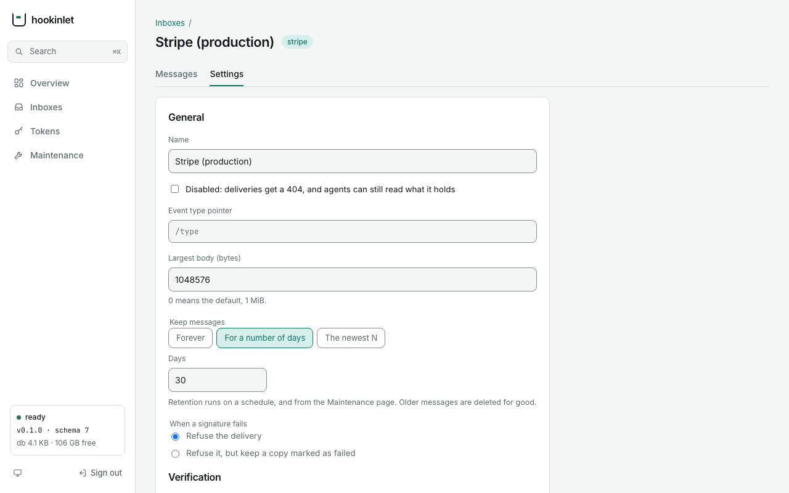

# Administration

This page covers everything that sets hookinlet up or looks after it. You can create inboxes, change their
settings, issue and revoke tokens, set retention, and take backups. There are two ways to do it, and both do
the same things:

- the **admin API**, on a running server, with the admin token;
- the **command line**. It calls the admin API when you give it `--url`. Without `--url`, it works directly in
  the data directory.

## Who may do this

The admin API accepts only the admin token (`HOOKINLET_ADMIN_TOKEN`, set when the server starts). An agent
token gets `403`. A missing or wrong token gets `401`. Neither one can tell what is behind the path. The admin
token can read every inbox and change everything, so treat it like a root password. Keep it in the environment,
never in a flag, and put TLS in front of the server. The server will not start if the token is shorter than 32
characters or mostly repeats itself. `openssl rand -base64 32` makes a good one.

A program that embeds hookinlet with its own `Authenticator` can also have a tenant's admin
([Tenants](extending.md#tenants)). A tenant's admin can work on that tenant's inboxes: create, list, show,
change, delete, set the verifier secret, and rotate the ingest key. Tokens, backups, retention runs,
`/v1/admin/status` and `/metrics` work on the whole store. A tenant's admin gets `403` on them. Only the
operator can use them. The admin token is the operator.

hookinlet logs every admin action (`"msg":"admin"`). The log says what was done and the caller's address
(`client_ip`). Behind a proxy, set `--trusted-proxies` so the log shows the caller and not the proxy. Tokens and
secrets are never logged.

### Keeping the admin API off the public address

By default the admin API is on the same address as ingest. Two settings take it off the internet:

- `--admin-listen-addr 127.0.0.1:9090` serves the admin API on its own address and nowhere else. The public
  address answers `404` for `/v1/admin/...`. The admin address answers `404` for everything that is not admin.
  This moves the *admin API* only. The admin token can still read every inbox through the read API and MCP on
  the public address. Keep it as secret as before, and give agents their own tokens. Reach the admin address
  over an SSH tunnel, a private network, or a proxy that you control. (In a container, bind it to an address
  that the container publishes only where you mean to.)
- `--admin-enabled=false` turns the admin API off. You then manage inboxes and tokens with the command line,
  which works in the data directory.

Responses are JSON and are never cached (`Cache-Control: no-store`). Errors use the same shape as the rest of
the API: `{"error": {"code": "…", "message": "…"}}`.

The admin API never returns a verifier secret, the sealed form of one, or a token hash. An inbox shows only
`has_verifier_secret: true`. A new agent token is shown exactly once, in the response that creates it.

## The API

| Method and path | Purpose |
|---|---|
| `POST /v1/admin/inboxes` | Create an inbox. Returns its first agent token (named `default`) once. |
| `GET /v1/admin/inboxes` | List inboxes, 100 at a time by default and at most 1000 (`?limit=`; follow `next`). |
| `GET /v1/admin/inboxes/{slug}` | Show one, with its message count. |
| `PATCH /v1/admin/inboxes/{slug}` | Change settings. |
| `PUT /v1/admin/inboxes/{slug}/secret` | Set or replace the verifier secret. |
| `POST /v1/admin/inboxes/{slug}/rotate-ingest-key` | A new random ingest key. The old URL stops working at once; give senders the new one. |
| `DELETE /v1/admin/inboxes/{slug}` | Delete the inbox and all of its messages (`204`). Readers, senders and tokens see the inbox as gone the moment the call starts. Its messages are then removed in small batches, so other inboxes keep receiving. If the server stops part way, the retention sweep finishes the job. `hookinlet retention run` does it at once, and is the way to do it if the sweep is off. Until then, the slug and ingest key stay taken. |
| `POST /v1/admin/tokens` | Issue an agent token for some inboxes (`inboxes`: a list of slugs) or all of them (`all_inboxes`), optionally one that expires (`expires_at`). Returns the token once. |
| `GET /v1/admin/tokens` | List tokens, never their secrets, with each one's `expires_at` and `last_used_at` when it has them (`?inbox=slug` for those that can read an inbox; `?limit=`; follow `next`). |
| `DELETE /v1/admin/tokens/{id}` | Revoke a token (`204`). It stops working at once. |
| `POST /v1/admin/retention/run` | Apply retention now. Returns `{"deleted": N}`. |
| `GET /v1/admin/backup` | Download a consistent copy of the database. |
| `GET /metrics` | Prometheus metrics (see [deploying](deploying.md#metrics)). |

Request bodies must be JSON (`Content-Type: application/json`, else `415`) and at most 64 KiB (else `413`).
They are strict. An unknown field, or anything after the JSON value, gets a `400`.

Other statuses:

- `404`: the inbox does not exist.
- `409`: a slug or an `ingest_key` is taken, a change could not be settled, or a sweep or backup is already
  running.
- `501`: you gave a verifier secret but no master key is set, or the Store cannot make backups.

The examples below write `$BASE` for the server's address (`export BASE=http://localhost:8080`) and
`$HOOKINLET_ADMIN_TOKEN` for the admin token.

### Create

<!-- exercise -->
```sh
curl -s -X POST "$BASE/v1/admin/inboxes" \
  -H "Authorization: Bearer $HOOKINLET_ADMIN_TOKEN" -H "Content-Type: application/json" \
  -d '{"slug": "stripe-api", "verifier": "stripe", "verifier_secret": "whsec_example",
       "retention_days": 30, "event_type_pointer": "/type"}'
```

```json
{
  "inbox": {
    "id": 1, "slug": "stripe-api", "name": "stripe-api", "version": 1,
    "verifier": "stripe", "verifier_config": {}, "has_verifier_secret": true,
    "on_verify_fail": "reject", "max_body_bytes": 1048576,
    "retention_days": 30, "retention_max_count": 0, "event_type_pointer": "/type",
    "disabled": false, "last_seq": 0,
    "ingest_key": "q3V9xR1hT0kYz2mP8uWb6A",
    "ingest_path": "/in/q3V9xR1hT0kYz2mP8uWb6A",
    "ingest_url": "https://hooks.example.com/in/q3V9xR1hT0kYz2mP8uWb6A",
    "created_at": "…", "updated_at": "…"
  },
  "agent_token": "hki_…"
}
```

`slug` (3 to 64 characters from `a-z`, `0-9`, and `-`; it never changes) and `verifier` are required. There is
no default verifier. Say how deliveries are checked, or say `none` to accept anything unchecked (stored as
**not** verified). The other fields are `ingest_key`, `name`, `verifier_config`, `verifier_secret`,
`on_verify_fail` (`reject`, the default, or `store`; see
[what a failed delivery gets](verifiers.md#when-verification-fails)), `max_body_bytes` (default 1 MiB, at most
10 MiB), `retention_days`, `retention_max_count`, and `event_type_pointer`. hookinlet checks the verifier and its
configuration when you save them. A typo is an error now, not a failed delivery later. See
[verifiers](verifiers.md).

**Retention and the clock.** Retention by age (`retention_days`) trusts the server's clock. Say the clock jumps
forward between two retention runs, for example after a VM resumes or a wrong time is corrected. A run that
trusted the clock would delete messages that are not yet due. So a run that finds the clock more than ten
minutes ahead of the time that really passed uses the time that really passed, and logs a warning. The next run
takes the clock as it then reads. A clock that stays where it jumped is the clock. Retention by count is not
affected. If a server's clock is wrong for good, fix the clock.

If you create an inbox with a verifier that needs a secret and give no secret, the response has a `warnings`
entry. Deliveries fail until you set the secret. Any change that leaves an inbox in that state returns the same
warning.

**The ingest key** is the `{key}` in the inbox's ingest URL. It works like a capability: whoever has it can post
to the inbox. So it is random by default (128 bits), not the slug. You may choose one (`ingest_key`, 3 to 64
characters from letters, digits, `_` and `-`) when a readable URL matters more than being unguessable.
`rotate-ingest-key` replaces it, and messages stay where they are. [Below](#why-the-ingest-url-is-not-the-slug)
explains why the key is not just the slug.

`ingest_url` is built from `HOOKINLET_PUBLIC_BASE_URL` if it is set. Otherwise it is built from the request's
`Host`. hookinlet uses `X-Forwarded-Proto` only when the request came from one of `HOOKINLET_TRUSTED_PROXIES`.

### Change settings

`PATCH` takes any of `name`, `verifier`, `verifier_config`, `on_verify_fail`, `max_body_bytes`,
`retention_days`, `retention_max_count`, `event_type_pointer`, and `disabled`. Fields you leave out stay as they
are. A disabled inbox answers deliveries with `404`, and agents can still read what it holds.

hookinlet checks each change against the inbox's version. If two admins change different settings of the same
inbox at once, both changes take effect. If they change the same setting, the last one wins. A conflict that
cannot be settled returns `409`, and you retry. `retention_days` is at most 36,500 (a hundred years).

### The verifier secret and the token

`PUT …/secret` takes `{"secret": "…"}`. hookinlet seals the secret with the master key before it stores it (see
`HOOKINLET_MASTER_KEY`). You cannot read it back.

### Tokens

An agent token has a name, a secret that is shown once, and a list of what it may read. That list is either a
list of inboxes (up to 100) or all inboxes, including ones created later. An inbox can have any number of
tokens. Creating an inbox issues its first token, named `default`.

To replace a token, issue the new one, give it to the agent, and then revoke the old one. Both work in between,
so the agent never has a moment with none. Revoking is also how you handle a leaked token. hookinlet refuses a
revoked token at once. Open SSE streams and MCP waits that used it end within about 30 seconds. They can take
longer if the server is too busy to check, as during a long backup of a large database under heavy load. The
stream then ends at the first check that succeeds. Deleting an inbox revokes the tokens that read only that
inbox. It leaves the rest.

<!-- exercise -->
```sh
curl -s -X POST "$BASE/v1/admin/tokens" \
  -H "Authorization: Bearer $HOOKINLET_ADMIN_TOKEN" -H "Content-Type: application/json" \
  -d '{"name": "billing-agent", "inboxes": ["stripe-api"]}'
# → {"record": {"id": 2, "name": "billing-agent", "all_inboxes": false, "inboxes": ["stripe-api"], …}, "token": "hki_…"}
```

A token for several inboxes names each slug. A token that reads everything says `"all_inboxes": true` instead.
Naming neither, or both, gets a `400`. Naming an inbox that does not exist gets a `404`. The name is for people.
It need not be unique, and it is not a secret.

An agent token can never use the admin API, however many inboxes it reads.

#### Expiry and last use

You can give a token a lifetime. This suits an agent or a job that should not hold a standing credential. Give
`expires_at` (a time in the future, RFC 3339) when you issue the token. On the command line, use
`--expires-in 30d` (a duration such as `720h`, or a number of days) or `--expires-at 2027-01-31T00:00:00Z`. From
that moment, hookinlet refuses the token with the same `401` as a token that never existed. Nothing in the
answer or its timing says the token once worked. A token issued without an expiry never expires. Every token
made before expiry existed behaves this way. You set the expiry once and cannot change it. To extend a token's
life, issue a new one, give it to the agent, and revoke the old one, as for any replacement.

An expired token stays in the list. `hookinlet token list` marks it `(expired)` so you can see it and revoke it.
It does nothing until you revoke it. A restore from a backup brings back tokens with the expiry they had.

A stream or MCP wait that was open when its token expired ends at the next re-check, within about 30 seconds
(`StreamRevalidateInterval`). This is the same as when a token is revoked: the stream is re-authenticated with
the same credential, and the server now refuses it. If the re-check cannot be made, the stream stays open (see
[What can end a stream](api.md#what-can-end-a-stream)).

`last_used_at` (the **LAST USED** column of `hookinlet token list`) is when the token last authenticated a
request. It helps you find tokens that nothing uses any more, which are safe to revoke. It is approximate on
purpose. hookinlet notes a use at most once every five minutes for each token, in the background, so reading
does not turn into writing. A stream that stays open keeps its token's time current through its re-checks. If
hookinlet fails to note a use, it logs the failure and the request is not affected. The field is empty for a
token that has not been used since the upgrade that introduced it, and for a Store that does not record it. A
`last_used_at` that lags by a few minutes is the design, not a fault.

### Why the ingest URL is not the slug

The ingest endpoint takes requests from anywhere. The key in the URL is the only thing that says which inbox a
request is for. A slug is a name you chose so people can tell inboxes apart (`stripe`, `github`, `billing`).
That makes it the first thing anyone would try. A guessed URL gets less than it looks like. On an inbox with a
real verifier, hookinlet refuses a request without a valid signature and stores nothing. But the guesser still
gets something:

- **It finds out what exists.** An unknown name gets a `404` and a known one gets a `401`. A scanner learns
  which inboxes you have, and that this is hookinlet.
- **It can fill a `none` inbox.** An inbox that checks nothing accepts whoever finds it. hookinlet stores what it
  takes as not verified, but it still stores it. Count-based retention then pushes real messages out.
- **It learns how busy you are.** Every accepted post answers with the next `seq`.

A random 128-bit key closes all three. There is nothing to guess. An unknown key and a wrong one look the same.
The signature is left to do what only a signature can do, which is to say who sent the request. The cost is a
URL nobody can remember. That is why the admin API and `inbox show` print it, and why `ingest_url` is built for
you. If a readable URL matters more to you, choose one with `ingest_key`. You are then trusting the signature
alone.

Treat the key like a webhook URL on a chat service. Keep it out of public places, and rotate it
(`rotate-ingest-key`) if it leaks. Messages stay where they are.

## The console

The server also serves a web console at `/admin`. It uses the same listener as the admin API, or
`HOOKINLET_ADMIN_LISTEN_ADDR` if the admin API has its own. The console is a page that calls the admin API with
the admin token. You type the token to sign in. It stays in the page's memory until you sign out or close the
tab. The console is on by default. `HOOKINLET_ADMIN_UI=false` turns it off, and it is off whenever the admin API
is off. The page and its scripts are static files built into the binary. The server serves them under a content
security policy that allows no inline script and no other origin. The console always shows message content as
text.

The console has:

- an overview (inboxes, activity over the last day, the last retention run);
- a list of inboxes;
- an inbox page with its messages. You can filter by event type, verification and time. You can read a message's
  body, headers and exact bytes. You can follow new messages as they arrive.
- a page to issue and revoke agent tokens.

It follows the system's light or dark theme, and you can switch the theme from its sidebar.

You can change settings in the console too. Creating an inbox picks the sender and asks only for what that
sender needs. An inbox's page has a Settings tab. There you can change the name, retention and verification,
replace the secret, rotate the ingest URL, and delete the inbox after typing its name. A Maintenance page runs
retention and downloads a backup. `⌘K` (or `Ctrl K`) opens a command palette to go anywhere or do anything by
name. The list and the inbox's own page mark an inbox whose verifier is `none` as unverified. The forms warn
while `none` is chosen.



The console adds no new way to change anything. Whatever it does goes through the endpoints in this document.
`GET /v1/admin/status` is the one endpoint it needed that did not exist (version, schema, database size, free
space, last retention run).

## The command line

<!-- exercise -->
```sh
# against a running server (HOOKINLET_ADMIN_TOKEN holds the admin token)
export HOOKINLET_URL=https://hooks.example.com
hookinlet inbox create --slug stripe-prod --verifier stripe     # secret: HOOKINLET_VERIFIER_SECRET (the verifier is required)
hookinlet inbox list
hookinlet inbox show stripe-prod
hookinlet inbox update stripe-prod --retention-days 30 --disabled=false
echo whsec_example | hookinlet inbox set-secret stripe-prod --secret-stdin
hookinlet token create --name billing-agent --inbox stripe-prod
hookinlet token create --name nightly-job --inbox stripe-prod --expires-in 30d
hookinlet token list --inbox stripe-prod
hookinlet inbox rotate-ingest-key stripe-prod
hookinlet inbox delete stripe-prod --yes
hookinlet retention run
hookinlet backup --out hookinlet-backup.db
```

To retire a token, look up its ID and revoke it:

```sh
hookinlet token list --inbox stripe-prod
hookinlet token revoke 2
```

You can also work without a server, straight in the data directory. Use this for first-time setup too. If
`HOOKINLET_URL` is set in your shell, unset it first. Giving both a server address and a data directory is an
error.

```sh
unset HOOKINLET_URL
hookinlet inbox create --slug stripe-prod --verifier stripe --data-dir ./data
```

- **Which mode.** `--url` (or `HOOKINLET_URL`) selects the API. It needs the admin token in
  `HOOKINLET_ADMIN_TOKEN`. Without it, the commands open `--data-dir` (`HOOKINLET_DATA_DIR`, default `./data`).
  Passing both `--url` and `--data-dir` is an error.
- **Secrets are never flags.** A verifier secret comes from `HOOKINLET_VERIFIER_SECRET` or, for `set-secret`,
  `--secret-stdin`. In direct mode, sealing the secret needs `HOOKINLET_MASTER_KEY`. The admin token comes from
  the environment. `--token` exists, but it shows up in process listings.
- **Direct mode needs a database.** Every command but `inbox create` refuses a data directory with no
  `hookinlet.db`. A mistyped `--data-dir` is an error, not an empty list or a backup of nothing.
- **Plain `http://`** to another machine is refused, because it would send the admin token in the clear.
  `--insecure-http` overrides that on a network you trust. `http://localhost` is always fine. The command does
  not follow redirects.
- **`--json`** prints the server's answer as JSON for scripts.
- You can use direct mode and a running server at the same time. The database is safe to share. The version
  check covers a change that lands between a command's read and its write.

## Applying a file

`hookinlet apply -f inboxes.yaml` brings a server's inboxes to the state a file describes. You can keep the file
in version control and repeat the setup. `apply` reaches the data the same way the other commands do (`--url`
and the admin token, or `--data-dir`). It only uses the admin API's own operations and rules.

<!-- exercise -->
```sh
export HOOKINLET_URL=https://hooks.example.com          # and HOOKINLET_ADMIN_TOKEN, as above
export STRIPE_WEBHOOK_SECRET=whsec_example              # the secret stays out of the file
export DEPLOY_EVENTS_TOKEN=made-up-shared-token

cat > inboxes.yaml <<'EOF'
inboxes:
  - slug: stripe-live
    name: Stripe (production)
    verifier: stripe
    secret_env: STRIPE_WEBHOOK_SECRET
    verifier_config: { tolerance_seconds: 300 }
    retention_days: 30
    event_type_pointer: /type
  - slug: deploy-events
    verifier: token
    secret_env: DEPLOY_EVENTS_TOKEN
    retention_max_count: 50000
EOF

hookinlet apply -f inboxes.yaml --tokens-out tokens.json --dry-run   # says what it would do; changes nothing
hookinlet apply -f inboxes.yaml --tokens-out tokens.json             # does it
hookinlet apply -f inboxes.yaml                                      # again: nothing to create or change
```

The second command prints:

```
created           stripe-live
secret set        stripe-live
created           deploy-events
secret set        deploy-events

2 created, 0 updated, 0 unchanged, 2 secrets set, 0 not managed
agent tokens of the new inboxes were written to tokens.json
```

The third prints `unchanged` for both inboxes, `secret set` for both, and no `created` lines.

**The file.** It has one key, `inboxes`, which is a list. Each entry is identified by its `slug` (3 to 64
characters from `a-z`, `0-9`, and `-`; it never changes). A new inbox also needs a `verifier`. `none` is a valid
choice, and hookinlet stores a delivery it accepts as not verified. An inbox that exists keeps its own verifier
if the file says nothing. The other keys are the admin API's fields, with the same names and the same rules,
because the same code checks them: `name`, `verifier`, `verifier_config`, `on_verify_fail`, `max_body_bytes`,
`retention_days`, `retention_max_count`, `event_type_pointer`, and `disabled`. You may declare `ingest_key` for a
new inbox. Leave it out to get a random one, which is what an inbox should have. `apply` does not change the key
of an inbox that exists. `max_body_bytes` cannot be `0` here. Leave it out to get the default.

**Secrets are never in the file.** A literal secret (`secret:` or `verifier_secret:`) is an error. Name where to
read the secret from instead, with one of:

- `secret_env: NAME`, an environment variable of the process running `apply`;
- `secret_file: /path`, a file (such as a mounted secret). Trailing newlines are not part of the secret.
  `apply` refuses a file larger than 4,096 bytes.

Giving both is an error. So is a source that is missing or empty. The error message points at the line of the
key. It does not repeat the variable name or the path, because a secret pasted under the wrong key would look
like one. `apply` never prints or logs secrets.

**What `apply` does.** For each entry, in order:

- If the inbox does not exist, `apply` creates it, with its secret and its agent token. Settings the file leaves
  out take the server's defaults.
- If the inbox exists, `apply` changes only the settings that differ from the file (one `PATCH`). It leaves alone
  the settings the file leaves out, so changes made by hand to those survive. A key with no value, such as
  `retention_days:`, is an error and not a zero. Leave the key out instead. `event_type_pointer: ""` is a
  setting too: it clears the pointer. `apply` compares `verifier_config` by meaning, not spelling.
- You cannot read a verifier secret back, so `apply` cannot tell whether it has drifted. When an entry names a
  secret source, `apply` sets the secret again on every run, and the summary says `secret set`. That changes
  nothing else about the inbox.

`apply` **never deletes** an inbox or a message. It leaves alone inboxes on the server that the file does not
mention, and lists them as `not managed`. (Removing an inbox is `inbox delete`, a separate and explicit act on
purpose.)

**Checked before anything changes.** `apply` reads the whole file first, and every secret source with it. These
are errors:

- an unknown key;
- a repeated key;
- a literal secret;
- a bad slug or setting;
- an anchor or alias;
- a second YAML document.

Each error names the key and its line. Nothing is touched, and the exit status is 2. `--dry-run` does all of
that, then prints what would be created and changed (`would create`, `would update: retention_days`) without
changing anything. A failure while applying stops at that inbox with exit status 1. The server may refuse a
setting, or it may be unreachable. What `apply` did before stays done. Run `apply` again to carry on, because
every step is safe to repeat.

Only the server can judge some settings, such as a verifier that an embedding program registered. The server
checks those when `apply` applies them. So that kind of mistake shows up at that inbox, not before.

**Agent tokens.** A new inbox's agent token is shown once. So `apply` writes it to the file named by
`--tokens-out`, as JSON (`{"stripe-live": "hki_…"}`), and prints it nowhere. `apply` creates the file new with
mode `0600` and never overwrites it. If the file already exists, or cannot be created, `apply` stops before
changing anything. `apply` replaces the file, atomically, as each inbox is created. So a failure part-way does
not lose the tokens already issued. If a run fails before any token was issued, `apply` removes the file again.
After a failure part-way, give the next run a new `--tokens-out` file. The first file keeps the tokens already
issued and is never overwritten. If a run would create an inbox and there is no `--tokens-out`, `apply` refuses
and changes nothing. A run that creates nothing needs no `--tokens-out` and does not touch it. So you can run the
same command line again.

`--json` prints the summary as JSON (`created`, `updated`, `unchanged`, `secret_set`, `not_managed`), also
without secrets or tokens. `-f -` reads the file from standard input.

## Retention

Each inbox can limit how much it keeps. `retention_days` deletes messages older than that many days.
`retention_max_count` keeps only the newest N. With both, a message goes if either rule says so. `0` means no
limit. Sequence numbers are never reused, so an agent's cursor stays valid after messages are pruned. It simply
finds nothing older.

From the command line (the verifier secret comes from `HOOKINLET_VERIFIER_SECRET`, never from a flag):

```sh
hookinlet inbox create --slug stripe --verifier stripe --retention-days 30
hookinlet inbox create --slug github --verifier github --retention-max-count 50000
```

The server applies every inbox's policy once when it starts. It waits until it is listening, so startup is not
delayed. After that it applies the policy every `HOOKINLET_RETENTION_INTERVAL` (default `1h`, at least `1s`, or
`off` to run only on request). `POST /v1/admin/retention/run` and `hookinlet retention run` do the same on
demand. Only one sweep runs at a time. A second request while one is running gets `409`.

A sweep deletes in small batches, limited by rows and by bytes, so deliveries keep flowing. We measured this
while a million rows were pruned (or an inbox that size was deleted) and senders appended. The store's append
p99 was 16 to 17 ms. See `docs/performance.md`. If shutdown interrupts a sweep, the next sweep resumes it.

## Backups

`GET /v1/admin/backup` (or `hookinlet backup --out FILE`) returns a complete, consistent copy of the database as
it was at one moment. Deliveries carry on while it is taken. The copy has every inbox, every message, the agent
token **hashes**, and the verifier secrets **still sealed**. It is useless without the master key, and sensitive
with it. Protect it like the data directory.

- The server writes the snapshot into the data directory first. That directory needs free space for a second
  copy of the database. Only the owner can read the temporary file, and the server removes it when the download
  ends, however it ends. If a crash leaves one behind, the server removes it at a later start, once it is more
  than an hour old. Until then it is a full copy of the database, so keep the data directory private.
- Only one backup runs at a time (`409` otherwise).
- While a backup runs, the write-ahead log cannot be reset. It grows by what is written in the meantime, and is
  cut back afterwards. We tested a 2.4 GB database copied under about 300 deliveries a second and 250 open
  streams. It took 2.5 minutes, and the log reached 1.2 GB, on top of the copy. A 2.6 GB database copied under
  the same load took 7 minutes. For that long, reads and admin calls were answered `503` "busy" or waited, while
  deliveries carried on. On the same machine with few streams, a 0.7 GB database took 3.5 seconds and the log
  stayed under 30 MB. Allow room for both the copy and the log. Take backups when the server is not at its
  busiest. Keep the copy time in mind when a large database is under heavy read load.
- A store that cannot produce a backup (some embedded backends) answers `501`.
- The command writes beside the destination and renames. So an interrupted backup never leaves a file that
  looks complete. It refuses to overwrite without `--force`.

**Restoring.** Stop the server. Remove any `hookinlet.db-wal` and `hookinlet.db-shm` beside the database. Put
the backup at `<data-dir>/hookinlet.db`. Start the server with the **same master key**. You can check the copy
first: `sqlite3 backup.db 'PRAGMA integrity_check'` should print `ok`. `hookinlet check --data-dir DIR` does the
same for a data directory (add `--quick` to skip comparing the indexes with their tables), and can run beside a
server. The server does not scan the database when it starts, which is why starting is fast. Run `check` after
a crash, a disk problem, or a restore.

To try a restore without touching the live data, put the backup in a directory of its own and check that:

<!-- exercise -->
```sh
hookinlet backup --out restore-test.db
unset HOOKINLET_URL        # a server address and a data directory together are an error
mkdir restored
cp restore-test.db restored/hookinlet.db
hookinlet check --data-dir restored
hookinlet inbox list --data-dir restored
```

Three things catch people out when restoring:

- **Leave no old `-wal` or `-shm` behind.** They belong to the database they were written for. SQLite applies a
  log it finds to whatever file is next to it. Next to a restored copy, that gives
  `database disk image is malformed` when the server (or `check`) opens it. Worse, you might get a database that
  opens and is wrong. That is why the step above says to remove them.
- **A file that did not finish copying.** The server refuses an empty `hookinlet.db` ("exists but is empty"). It
  does not start a new, empty database. Copy the backup again.
- **A backup from an older release** needs that release's migrations before you can check it. `hookinlet check`
  refuses it and says to run `hookinlet migrate` (with the server stopped), which keeps a copy of the file as it
  was. Starting the server does the same.

A backup that you download with `curl -o` is created with your shell's `umask`. A backup holds everything the
data directory does. `(umask 077; curl -s ... -o backup.db)` keeps it private, as `hookinlet backup --out` does.

**Epochs.** A restored server may hand out sequence numbers that differ from the ones the original handed out
after the backup was taken. So cursors held from before must not be believed. Each snapshot from
`GET /v1/admin/backup` or `hookinlet backup` therefore has a **new epoch** for every inbox. Readers using
[`epoch`](api.md#epochs-and-gaps) are told to start again. The snapshot holds no
[named readers'](api.md#named-readers-and-lag) positions either. A position is a sequence number of one epoch,
so a restored server starts with none and its readers acknowledge again. The snapshot cannot cover two cases: a
**copy of the data directory** made with the server stopped, and **one snapshot restored more than once**. After
restoring either, with the server stopped, run

```sh
hookinlet renew-epochs --data-dir ./data
```

which gives every inbox a new epoch in place.

A reader that does not send `epoch=` gets no such signal. Two cases:

- A cursor that is behind the restored `latest_seq` reads on as if nothing had happened. The messages after it
  are no longer necessarily the ones it saw.
- A cursor that is ahead of it gets an empty page, or a stream that waits, until new deliveries pass it. This is
  the usual case, when the backup is older than the reader. The messages in between are skipped.

The page does carry the new `epoch`, and a `latest_seq` below the reader's cursor is the tell. Agents that must
not lose messages should send the `epoch` they were given, as the `next` links do.

**A restore also undoes what changed after the snapshot.** Say you revoked a token, rotated an ingest key, or
disabled an inbox because something leaked. In a database restored from before, that token, key or inbox is live
again. After a restore, check `hookinlet token list` and the ingest URLs of your inboxes. Revoke and rotate again
what you had.
